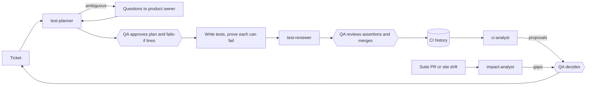

# Agents Plan

How AI agents would turn tickets into tests, prove those tests can fail, review them, point out what a change puts at risk, track CI trends and keep the suite relevant, with QA reviewing where it matters most. Nothing is built yet.

The short version: **agents own the *how*; QA owns the *what*, and anything that removes coverage.** Each agent starts at a low level of autonomy and moves up only on measured evidence.

## At a glance



- **Two QA gates per ticket:** the plan, including a "fails if" line per test, and the assertions at merge. Everything else is checked by agents, scripts or ESLint.
- **Every new test proves it can fail.** The agent breaks the behaviour, and a script confirms the test fails at the intended assertion. QA reads that evidence instead of every line of code.
- **Changes, not just tickets.** `impact-analyst` maps a PR, or a nightly change on the live site, to the tests and tickets it puts at risk.
- **Autonomy is earned.** Each action sits at L1–L3, moves up on metrics and down on a failed spot check, with the evidence in `agents/autonomy.md`.
- **Measured, cost included.** Time, interventions, tokens and QA minutes per merged test. Every run is safe to repeat, stuck runs stop and say so, and one switch turns all agents off.

## Open questions

1. **Seeded stories.** Can 6–10 `demo-story` Issues be public on the repo? The alternative, Markdown tickets only, loses the visible clarification and approval trail.
2. **Subscription token in CI.** Can the unattended loop run in GitHub Actions on your Claude subscription (see [The unattended loop](#the-unattended-loop))? It costs no credits but uses your plan's usage limits. If not, the same loop runs from your machine instead.
3. **Playwright's built-in agents:** adapt them or build our own? Recommended: adapt (see [Alternatives](#alternatives-and-ideas)).
4. **Curator:** a separate agent, or a mode of `ci-analyst` for now? Recommended: a mode.

## Goals

1. Read tickets and the codebase to work out which tests to write, including tests the ticket doesn't mention.
2. Ask for clarification instead of guessing when a ticket is ambiguous.
3. Prove each new test fails when the behaviour it covers breaks.
4. Review new tests for conciseness and the project's standards.
5. Point out which tests and tickets a change puts at risk, and which gaps it exposes.
6. Report CI trends over time.
7. Propose adding or removing tests to QA, based on relevance.

## Constraints

This is a demo:
- **No Jira.** Agents read tickets through a swappable [ticket source](#ticket-source). It's GitHub Issues in the demo and would be Jira, through Atlassian's MCP server, in a real team.
- **No Anthropic credits.** No pay-as-you-go API key is used. AI runs in Claude Code under the existing subscription: interactively, and optionally unattended through a subscription token (open question 2). Every other CI step is a script, which is free on a public repo.
- **No product code.** automationexercise.com isn't ours, so there are no product diffs to analyse. The demo shows impact analysis on the suite's own PRs and on nightly changes to the live site, and the plan describes the real-team version (see [`impact-analyst`](#4-impact-analyst-change-to-risk)).

Where a real team would do something differently (Jira, API keys, product diffs, schedules), the plan says so, so the design is complete even where the demo doesn't run that part.

## Principles

- **Agents propose, people decide, at first.** Agents start by only opening PRs, Issues and comments. They gain more autonomy only by earning it (see [Autonomy levels](#autonomy-levels)), and some decisions always stay with QA (see [Where QA reviews](#where-qa-reviews)).
- **Evidence over reading code.** Wherever possible, QA reviews evidence an agent produced and a script verified, such as a failure proof, rather than the code itself.
- **Scripts count, the model interprets.** Metrics are computed from Playwright's JSON output and GitHub data by scripts, never by the model, so reports are reproducible.
- **The existing docs are the rules.** Agent prompts point to CLAUDE.md, CODING_STANDARDS.md and TEST_STRATEGY.md and never restate them, so the rules can't drift.
- **The author never reviews its own work.** The reviewer runs in a fresh context.
- **Least privilege.** Read-only agents get read-only tools. Only the writing step edits files, and no agent merges to `main`.
- **Deterministic checks beat LLM checks.** When the reviewer keeps flagging the same thing, that rule moves into ESLint.
- **Fail closed, and say so.** Every step is safe to repeat. A step that can't finish stops, labels the ticket `agent-stuck` and explains why, rather than retrying forever or working around the problem.
- **Measure the agents, not just the tests.** Claims about speed-ups and cost are backed by [metrics](#agent-metrics), not impressions.

## Where QA reviews

The rule: **put QA where an agent's mistake would go unnoticed, and skip them where a mistake shows up on its own.** A wrong locator shows up: the test fails. A test that asserts the wrong thing and passes doesn't, and neither does a deleted test.

**QA always reviews:**
1. **The plan, before any code is written.** QA approves the coverage map, including the suggestions beyond the ticket and each test's "fails if" line. It's the most valuable review point and the cheapest: reading the intended tests takes minutes, reading their code takes much longer.
2. **Assertions, at merge.** The reviewer agent covers style and standards. QA checks one thing: does each test prove the behaviour its criterion describes? The [failure proof](#3-failure-proof) answers most of that: QA reads its table and reads the code only for the tests it flags.
3. **Anything that reduces coverage.** Deleting, quarantining, changing tier, loosening an assertion, or adding accessibility or visual baseline entries. Agents may propose these, never do them.
4. **Changes to the agents.** Prompt changes go through PR review with the eval results attached.

**QA doesn't need to be involved, eventually:**
- Style and standards review.
- Triaging environmental failures (520s, queue-full pages).
- Collecting history and writing trend and impact reports.
- Clarification questions. Those go to the product owner, not QA.
- Locator-only fixes such as a renamed button, once the agent has a track record. The assertions must stay unchanged.

**Spot checks replace blanket review.** Once a step runs on its own, QA reviews a sample of its output, about 1 in 10 a week. Mistakes in the sample move the step back down a level.

In the demo, you play both product owner and QA.

## Autonomy levels

Each agent's actions sit at one of three levels:
- **L1 Suggest:** the agent proposes, and a person does it.
- **L2 Act with approval:** the agent prepares the change (a comment, label or PR), and a person approves it before it takes effect.
- **L3 Act, then spot check:** the agent acts alone, and QA samples its output.

Actions move up when their metrics pass a threshold over a set period, and move down when a spot check finds a mistake. The level of each action, and why, is recorded in `agents/autonomy.md`, so the current trust level is visible and reviewable. The thresholds below are sized for a suite of about 35 tests. With samples this small they're a starting point, and a larger suite would raise them.

Starting levels and limits:
- **Posting clarification questions:** L3 from the start. It changes nothing, and the product owner answers.
- **Trend and impact reports:** L3 from the start. They only report. Any action they propose is L1.
- **Classifying environmental failures:** starts at L1. Moves to L3, where it labels them on the nightly-failure Issue, once 20 classifications in a row match a hand check.
- **Style findings:** start at L2 as advisory PR comments. Move to L3, where the agent pushes style-only fixes to its own PR, once 95% of at least 20 findings are accepted.
- **Locator-only fixes:** start at L2 as a PR. L3 (merging them alone) is possible for a real team but stays off in the demo, so no agent merges to `main`.
- **Resuming a stuck run:** L1. A person reads the explanation and re-adds the label.
- **Plan approval, merge, and anything that reduces coverage:** capped at L2 for good. These are QA's.

## Architecture

Agents run in one of three modes:
- **Interactive:** subagents in `.claude/agents/`, chained by skills in `.claude/skills/`. This is how every agent is built and tested.
- **Unattended AI:** `anthropics/claude-code-action` in GitHub Actions. The demo runs one loop this way with a subscription token (open question 2). A real team would use an API key and run more of the agents this way.
- **Unattended scripts:** plain Actions jobs that collect test history, agent runs, site snapshots and agent metrics, in both the demo and a real team.

Agents read only from the repo, the ticket source and the history store. They write to files or comments, never to the chat alone, so moving one from interactive to unattended means adding a workflow, not rewriting the agent.

The planner uses Playwright MCP (`@playwright/mcp`, free) to check the live site and choose real locators.

The flow, end to end:
1. `test-planner` reads a ticket and maps its acceptance criteria, and the risks around them, to tests, each with a "fails if" line.
2. The clarification gate sends any questions to the product owner on the ticket, and waits for answers.
3. **QA approves the plan.**
4. The main session (or the unattended loop) writes the tests, and the failure proof shows each one fails when its behaviour breaks.
5. `test-reviewer` checks them, and a PR is opened. **QA reviews the assertions and merges.**
6. After merge, CI runs feed the test history (scripts only).
7. `ci-analyst` reports trends from that history.
8. `impact-analyst` comments on suite PRs and on nightly site changes with the tests and tickets at risk.
9. `suite-curator` combines trends, impact gaps and ticket coverage into proposals. **QA decides on them**, which leads back to new tickets or test changes at step 1.

### Ticket source

Agents need only four operations on tickets. Each one maps to a `gh` command in the demo and a Jira call in a real team:
- **Read a ticket** (summary, description, acceptance criteria, labels, comments): `gh issue view <n> --json …`, or Atlassian MCP `getJiraIssue`.
- **List tickets ready for automation:** `gh issue list --label ready-for-automation`, or a JQL search.
- **Comment:** `gh issue comment`, or Jira's add-comment call.
- **Add or remove labels** (`needs-clarification`, `plan-review`, `plan-approved`, `agent-stuck`): `gh issue edit`, or Jira's edit-labels call.

Details:
- **Demo tickets** are Issues created from `.github/ISSUE_TEMPLATE/user-story.yml`, which has Jira-style fields: summary, user story, acceptance criteria, priority and component. They're labelled `demo-story`. Their comments make the clarification and approval loop visible.
- **Eval tickets** are Markdown files in `agents/evals/tickets/`, because evals need input that never changes.
- **Why not free Jira Cloud?** It's free too, but it needs an account and an MCP login that visitors can't see. Issues sit next to the code and are public.

### The unattended loop

One loop runs end to end without anyone at a keyboard, and both QA gates stay in place:
1. You add `ready-for-automation` to a `demo-story` Issue.
2. An Action runs the planner. It posts questions (`needs-clarification`), or posts the coverage map and adds `plan-review`.
3. You approve by adding `plan-approved`.
4. An Action writes the tests, runs them on `chrome` with `--repeat-each=3`, runs the failure proof and the reviewer, and opens a PR linked to the Issue.
5. You review the assertions and merge.

A nightly scheduled Action also runs `/ci-trends` and the site-drift check.

How it runs without credits:
- `claude-code-action` accepts a subscription OAuth token, created with `claude setup-token` and stored as a repo secret. It uses your plan's limits, not credits, and suits a personal repo only.
- Only labels trigger it, and only the owner can add labels. Forked PRs get no secrets, so strangers can't start it.
- Turns per run are capped, and runs are limited to `demo-story` Issues.

**Fallback (no token in CI):** `/loop` in a local Claude Code session checks for labelled Issues and runs the same steps. It leaves the same trail on GitHub, but it needs your machine to be on.

### Failure handling

The labels form a state machine: `ready-for-automation` → `needs-clarification` or `plan-review` → `plan-approved` → PR open → merged, with `agent-stuck` reachable from any state. Each step reads the current labels before acting and does nothing if the ticket isn't in the state it expects, so running a step twice is harmless.

- **The ticket changes after the plan is approved.** The planner ends its plan comment with a hidden `<!-- plan-hash: … -->`, a hash of the acceptance criteria and the plan. `plan-approved` is valid only for that hash. A script recomputes it before writing, and on every `issues: edited` event. If the hash has changed, the script removes `plan-approved`, adds `plan-review` back, and comments with the criteria that changed. QA approves the new plan, not the old one.
- **Runaway runs.** Turns are capped with `--max-turns`, and every job sets `timeout-minutes`. A `concurrency: agent-issue-<n>` group stops two runs from working on the same ticket.
- **Repeated failure or usage limits.** After two failed attempts at a step, or on a usage-limit error, the run adds `agent-stuck`, comments with the reason and the run link, and stops. Re-adding the step's label resumes it.
- **The agent's PR fails CI, or is flaky under `--repeat-each=3`.** The agent gets one fix attempt, limited to the files it wrote. It may not change an assertion, tier or baseline to get a pass, because that's healing. If the PR is still red, it becomes a draft with a failure analysis, and the ticket gets `agent-stuck`.
- **The site is down while the agent works.** Queue-full pages, Cloudflare 520s and hung POSTs are classified as environmental, following the flakiness policy. The run waits and retries later; it never edits a test because of them.
- **Conflicts with `main`.** The agent rebases once. If the conflict remains, the ticket goes to `agent-stuck`.
- **Kill switch.** Every agent workflow checks the repo variable `AGENTS_ENABLED` first and exits when it's `false`. Script-only jobs keep running, so history has no gaps.

## Agents

### 1. `test-planner`: ticket to test plan

- **Trigger:** `/test-from-ticket 42`, or the `ready-for-automation` label in the unattended loop.
- **Tools:** read-only. Ticket reads, Read, Grep, Glob, and Playwright MCP for browsing only.
- **Steps:**
  1. Read the ticket, including linked tickets and comments.
  2. Read the existing tests, page objects and fixtures for the feature.
  3. Browse the live pages to confirm behaviour and locators.
  4. Produce a **coverage map** that gives each acceptance criterion a status: covered, missing, out of scope, or conflicts with the site. For example (an illustrative ticket):
     - *Guest can add a product to the cart:* **covered** by `tests/cart.spec.ts` "should add product…".
     - *Cart shows the line total:* **missing**, so add a new `@regression` test in `cart.spec.ts`.
     - *API returns 201:* **out of scope**, because API assertions are excluded (TEST_STRATEGY "Scope").
     - *Quantity can be edited in the cart:* **conflicts with the site**, where cart quantity is read-only.
  5. Add **suggestions beyond the ticket**, kept separate from the criteria:
     - *Implied cases:* the negative and edge cases behind each criterion. For "user can log in", that's wrong password, empty fields and an already-logged-in user.
     - *Knock-on risk:* existing features the change could break, found from the code. A cart change touches checkout, for example, and the agent checks whether those tests already cover it.
     - *Other kinds of checks:* whether it needs an `@a11y` scan, a visual baseline or a mobile smoke test.
     - *Site gotchas* from CLAUDE.md that apply, such as a guest cart surviving login.

     Each suggestion is a numbered option with a reason, ranked by TEST_STRATEGY priority. There are at most about five. The rest are listed as "considered, not proposed", and out-of-scope ideas are left out. Nothing beyond the ticket is written unless QA picks it.
  6. For each test to write, propose the spec file, `should … when …` name, tier tag, starting fixture, any new page-object members or `TestDataFactory` methods, and a **"fails if" line**: the broken behaviour the test must catch. For the line-total test, that's *fails if the line total isn't price × quantity*. Each line becomes a sabotage in the [failure proof](#3-failure-proof).
  7. Run the clarification gate, then post the plan, with its hash, for QA approval (`plan-review`).
- **Writing** happens in the main session, so you can see and steer it, or in the unattended loop. It follows CONTRIBUTING.md, then runs `typecheck`, `lint` and the spec on `chrome` with `--repeat-each=3 --workers=2`, then the failure proof.
- **Traceability:** each test records its ticket as an annotation, so the link is in the code and the HTML report, and the impact analyst and curator can use it:
  ```ts
  test('should show line total for each cart item', {
    tag: '@regression',
    annotation: { type: 'issue', description: '#42' },
  }, async ({ cartPage }) => { … });
  ```
- **Site safety:** while browsing, the planner never submits forms, creates accounts (only the fixtures may) or visits `/delete_account`.

### 2. Clarification gate

This is a step inside the planner, not a separate agent, because a separate agent would need all the planner's context anyway. "Ask when unsure" is too vague to apply consistently, so the gate blocks writing when any of these holds:
- The ticket has no acceptance criteria. The agent suggests criteria for the product owner to confirm instead of only asking.
- A criterion has no observable outcome ("cart works correctly"), so no "fails if" line can be written for it.
- Test data isn't specified and isn't in the fixed catalogue.
- The ticket conflicts with known site behaviour (the CLAUDE.md gotchas).
- The ticket asks for something out of scope (API, performance, unit).
- A proposed test overlaps an existing one.
- It's unclear whether the test is smoke or regression.

When the gate blocks:
1. **On the ticket:** the agent posts one comment with the questions, each with options and a recommendation. It adds `needs-clarification` and stops. Running the planner again reads the replies and continues.
2. **In the session:** if you can answer straight away, the questions are asked as multiple choice and the answers are posted to the ticket, so the ticket stays the record.

Assumptions that don't block writing go in the PR description for the reviewer and QA to check. A seeded ambiguous ticket demonstrates the whole loop.

### 3. Failure proof

A test that can't fail proves nothing, and reading code is a slow way to find one. This step, part of writing and not a separate agent, shows that each new test fails when the behaviour it covers breaks. It's mutation testing at the scale of one test.

1. **Sabotage.** For each test, the agent makes a temporary copy with a sabotage, injected before the action, that matches the test's approved "fails if" line. The sabotage is usually a `page.route` that fetches the real page and fulfils a modified body, or a DOM change through `addInitScript`.
2. **Change values, not presence.** When an assertion checks a value, the sabotage changes the value (Rs. 500 becomes Rs. 499) rather than removing the element. Removing the element would make almost any test fail on a timeout, so it would prove nothing about the assertion.
3. **Check where it failed.** `scripts/verify-failure-proof.ts` runs each copy once and reads Playwright's JSON report. The proof passes only if the test failed **at the assertion the "fails if" line names**, matched by its location in the file. A locator timeout, a different step or a passing test fails the proof. The script decides this, not the model.
4. **Clean up.** The copies are deleted and never committed.
5. **Report.** The PR description gets one row per test: the "fails if" line, the sabotage, where the test failed, and whether the proof passed.

A test whose proof fails is flagged for a full QA review of its code. So is a test whose behaviour can't be sabotaged from the browser. The reviewer also checks that each sabotage matches its "fails if" line, so a weak sabotage can't pass as a strong one. In a real team with product code, a mutation tool such as Stryker on the product side would do the same job more thoroughly.

### 4. `impact-analyst`: change to risk

In an agentic company the hard question isn't "which tests does this ticket need?" but "this PR changed X, so what's at risk?" There's no product code here, so the demo answers that question for the two kinds of change it does have.

**Suite PRs (deterministic first).**
- PR CI also runs `npx playwright test --project=chrome --only-changed=origin/main`. Playwright selects the specs whose import graph touches the changed files. That selection is a script, not the agent.
- `/impact` (or the PR workflow) adds what an import graph misses:
  - which fixtures and page-object members the diff changes;
  - which tests use them;
  - which tickets and criteria those tests trace to, through their `issue` annotations;
  - gaps: changed behaviour that no test covers.
- **Output:** one PR comment, such as "Changes `CartPage.removeItem`. Affects 4 tests on #12 and #19. No test covers removing the last item." Gaps go to the curator as proposals.

**Site drift (a proxy for releases).**
- `scripts/snapshot-site.ts` runs nightly. It records `locator.ariaSnapshot()` of stable regions on the key pages, such as the header, cart table, forms and checkout steps, and stores the results in `ci-history`. Like the visual checks, it leaves out regions with products, prices or user data. It's a script, not a test, so it doesn't count toward the suite.
- When the structure differs from the previous night, the agent maps the change to the page objects and tests it affects. For example: "Proceed To Checkout became a `button`: `CartPage.proceedToCheckout` and 3 checkout tests are at risk." This happens before those tests fail, and it separates a real site change from flakiness.
- **Output:** a dated comment on the `ci-trends` Issue.

**In a real team:** the agent reads each product PR's diff and maps changed files to components through per-test V8 coverage collected nightly. It ranks the risk, chooses the tests to run on that PR, and lists the gaps. QA's job then becomes deciding which gaps matter, not writing every test. This is the agent a solo QA needs most when coding agents ship many PRs a day.

### 5. `test-reviewer`: standards review

- **Trigger:**
  - Automatically after writing, in both interactive and unattended runs.
  - `/review-tests` on any branch, including human-written changes.
  - `/review-tests --pr 17`, which also posts the findings to the PR through `gh`.
- **Tools:** read-only. Read, Grep, `git diff`, plus `gh pr comment` in `--pr` mode.
- **Checks only what ESLint and `tsc` can't:**
  - Locator priority, exact names, and no `.first()`/`.nth()`/`.or()` hiding ambiguity.
  - Getters for locators, the SELECTORS/ACTIONS layout, return types.
  - Fixtures instead of `new`, and only the starting page's fixture.
  - Behavioural test names, `test.step` in multi-phase tests, exactly one tier tag.
  - Data from `TestDataFactory` that is unique per call.
  - Comments that explain *why*, and no JSDoc that only repeats a name.
  - Duplicated setup, and assertions an existing test already makes.
  - Whether each sabotage in the failure proof matches its "fails if" line.
  - Whether each test really checks the acceptance criterion it claims. This flags the test for QA; it doesn't replace QA's review.
- **Checklist** is generated from the CODING_STANDARDS.md headings. Each finding cites the standard it breaks.
- **Feedback:** you react 👍 or 👎 to each finding. That feeds its acceptance rate in the metrics and decides when style fixes reach L3.
- **Findings are advisory.** No required CI check runs the reviewer, so it can't block a merge.
- **Quarterly:** the most frequent findings that can be detected mechanically become ESLint rules (custom or from `eslint-plugin-playwright`) and leave the checklist.

### 6. `ci-analyst`: trends

Today CI shows one run at a time, and the nightly-failure Issue gives only a rough history.

**Step 1: history, scripts only, free, every run.**
- Add the `json` reporter next to `blob`.
- After the report merge, `scripts/collect-test-history.ts` appends one record per test per run: ID, title, file, project, tags, status, retries, duration, error, commit, run URL and trigger.
- The records go to JSON files on a `ci-history` branch, and the job gets `contents: write` there only. This store is free, versioned, and readable by the agent and the Pages report. Artifacts expire within 90 days, and a database is more than a demo needs.
- The same branch holds the agent-run records (see [Agent metrics](#agent-metrics)) and the nightly site snapshots.
- The script also draws a trend page in the Pages report: pass rate, flaky rate and duration per week. It's visible even when nobody has run the agent.

**Step 2: the agent, run with `/ci-trends`** (or nightly in the unattended loop).
1. `scripts/summarise-test-history.ts` computes per test, over 7 and 30 days: pass rate, flaky rate (passed on retry), failures, p50/p95 duration and trend.
2. The agent groups failures by error signature and separates environmental causes from test or site defects, following step 2 of the flakiness policy. Environmental causes are queue-full pages, Cloudflare 520s, dropped connections and the rest of the TEST_STRATEGY list. The shared site makes this noise common, which makes it a good demonstration.
3. It reports what's new, worse and better, the top flaky tests with traces, slow tests, and whether the environment is degrading (a problem with the shared site, not the suite).
4. It proposes actions under the flakiness policy, such as "quarantine X with `test.fixme()`, draft Issue attached". Quarantining reduces coverage, so it never applies them.

**Output:** a dated comment on one `ci-trends` Issue per run, so the reports build up in one place.

### 7. `suite-curator`: relevance

- **Trigger:** `/review-suite`. A real team would run it monthly.
- **Inputs:**
  - Ticket annotations mapped against ticket priority.
  - The analyst's summary: flakiness, minutes, failures that caught real defects.
  - Gaps reported by `impact-analyst`.
  - TEST_STRATEGY "Priorities", plus components ranked by recent bugs. Bugs filed in [docs/bugs/](docs/bugs) count as evidence for keeping a test.
  - Tests that overlap in journey and assertions.
- **Output:** proposals to keep, merge, remove, move tier or add, each with evidence and options. For example (these test names are made up):
  > **Merge** `products.spec.ts` "should show search results" into "should show matching product names". Same journey, and the second assertion covers the first. Saves about 40s per browser. Options: (a) merge, (b) keep both, (c) move one to nightly only.

  QA decides on the Issue or PR before any test changes.
- **"Never fails" isn't "useless".** Checkout smoke tests guard the highest-impact journey. The curator weighs impact above failure history and says so.
- **This is the weakest agent for now.** With about 35 tests and a few weeks of history, it has little to work with. Start it as a "Relevance" section of `/ci-trends`, split it out only if it grows, and don't lead the demo with it.

## Agent metrics

**Recording runs.** Every agent run appends one record to `ci-history`: agent, prompt version, ticket or PR, stage, turns, input and output tokens, notional cost, duration, and outcome (`done`, `blocked`, `stuck` or `abandoned`).
- **Unattended runs** take these from Claude Code's JSON result, the execution file `claude-code-action` writes.
- **Interactive runs** use a `SessionEnd` hook that reads usage from the session transcript.

`scripts/agent-metrics.ts` computes these from the run records, GitHub data (Issue and PR timestamps, labels, reactions, commit authors), failure-proof results and eval results. They appear on the Pages trend page:
- **Ticket to merged test:** time from `ready-for-automation` to merge, split into waiting for clarification, waiting for QA, and agent work.
- **Cost per merged test:** tokens, plus a notional dollar cost at API prices. It's labelled notional because the demo runs on a subscription, but it's what a real team would pay.
- **Wasted runs:** runs that ended without a merged result, and why (stuck, plan rejected, ticket changed, usage limit).
- **Turns per stage,** and the share of the plan's usage limit the agents use each week.
- **QA review minutes:** self-reported in a PR template field. It's imperfect, but QA time is the expensive part, and timestamps measure waiting, not effort.
- **Interventions:** how often a person had to change an agent's PR, and why (wrong assertion, wrong locator, style).
- **Plan acceptance:** how many proposed tests QA approved, including suggestions beyond the ticket.
- **Failure-proof pass rate:** how many new tests failed at their intended assertion the first time.
- **Reviewer acceptance:** findings marked 👍 vs. 👎.
- **Eval pass rate** for each prompt version.
- **Spot-check results** for every L3 action.

These numbers decide the autonomy levels. They also test the "10x" claim honestly: the expected finding is that the bottleneck moves from writing code to clarification and review, so the metrics show where the remaining time and money go.

## Alternatives and ideas

- **Playwright's built-in test agents.** Playwright 1.56+ ships `planner`, `generator` and `healer` (`npx playwright init-agents --loop=claude`), and the repo is on 1.57. They're a free starting point for agent 1, with two cautions:
  - The generator doesn't know these standards, so it needs CLAUDE.md as context and the reviewer after it.
  - **No automatic healing.** Changing locators or assertions to make a test pass can hide real defects and breaks the flakiness policy. At most, the healer opens a locator-only PR that explains the root cause, under the locator-fix autonomy rules.

  Adapting them means less to build, and showing where *not* to trust them is good portfolio material.
- **Agent evals.** `agents/evals/` holds 5–8 golden tickets with expected outcomes: clear, ambiguous, no acceptance criteria, out of scope, conflicting with the site, and overlapping an existing test. One seeded test that can't fail checks that the failure proof catches it. Rerun the evals whenever a prompt changes, and attach the results to the prompt's PR.
- **Ticket text is untrusted,** because anyone can open an Issue on a public repo:
  - The agents read only Issues labelled `demo-story`, and only the owner can add labels.
  - Ticket access is read plus comment and label only.
  - The reviewer and QA still sit before `main`.
- **A real team's setup:** Jira through Atlassian's MCP server, `claude-code-action` with an API key on every PR and on a schedule, `impact-analyst` on product PRs with per-test coverage, a smaller model for review and classification, turn caps, and docs-only PRs skipped.

## Delivery phases

Each phase is one PR, and none of them uses credits. History goes first, because trends need weeks of data and it costs nothing to start.

1. **History.** Delivers the JSON reporter, the collector and summariser scripts, the `ci-history` branch, the agent-run record format with the `SessionEnd` hook, and the trend page. Needs nothing. Done when it records every CI run and every interactive agent session. Two weeks of data are needed before phase 5.
2. **Reviewer.** Delivers `test-reviewer`, `/review-tests` (with `--pr`) and 👍/👎 feedback. Needs nothing. Done when it flags every issue planted in a seeded bad test.
3. **Impact on suite PRs.** Delivers the `--only-changed` CI step, `impact-analyst` and `/impact`. Needs nothing; it maps changes to tickets once phase 4 adds annotations. Done when a PR that changes a page object gets a comment naming every affected test, checked by hand.
4. **Planner and failure proof.** Delivers:
   - the story template, 6–10 `demo-story` Issues, `test-planner` with suggestions beyond the ticket and "fails if" lines, the gate, plan approval labels with the plan hash, `/test-from-ticket`, and ticket annotations;
   - the failure proof and `scripts/verify-failure-proof.ts`;
   - the evals and `agents/autonomy.md`.

   Needs phase 2. Done when all evals pass, the seeded test that can't fail is caught, and one Issue shows clarification, plan approval, a failure-proof table and a merged PR.
5. **Trends and site drift.** Delivers `ci-analyst`, `/ci-trends`, environmental classification, flakiness proposals and the nightly site snapshot. Needs phase 1 plus two weeks of data. Done when the first report matches a hand check of the same runs.
6. **Unattended loop and metrics.** Delivers the label-driven Actions (or the `/loop` fallback), failure handling and the kill switch, the nightly `/ci-trends`, `scripts/agent-metrics.ts` and the metrics page. Needs phases 4 and 5. Done when one ticket goes from label to merged test with only the two QA approvals in between, and an edited ticket correctly loses its plan approval.
7. **Relevance.** Delivers relevance proposals, as a section of `/ci-trends` or a separate curator. Needs phases 3, 4 and 5. Done when one proposal has been discussed and acted on.

## Showcasing it

- **A case study in the README.** Follow one ticket from Issue to merged test, linking the real clarification comment, plan approval, failure-proof table, reviewer findings, PR and report. Visitors click through a trail; few read a plan.
- **The metrics page** shows the agents measured, cost included, and where people still step in.
- **`agents/autonomy.md`** shows each action's current level and the evidence for it.

As phases ship, split this plan by reader:
- **README "Agents" section, one screen:** the diagram from [At a glance](#at-a-glance), its five bullets, a status table per phase, and the case-study link.
- **`agents/README.md`:** current autonomy levels and their evidence (the `autonomy.md` content).
- **This file moves to `agents/DESIGN.md`** as the full reference. Each built phase's section is rewritten to describe what exists, and its aspirational parts are deleted.

Docs to update along the way:
- CLAUDE.md: a new "Agents" section listing the agents, their triggers, autonomy levels and the kill switch.
- CONTRIBUTING.md: how to start from a ticket, how QA approves plans, and how to read a failure-proof table.
- TEST_STRATEGY.md: the agents' role in triage and impact analysis, QA gates, and the pipeline.
- README.md: the case study and links to the metrics page.
