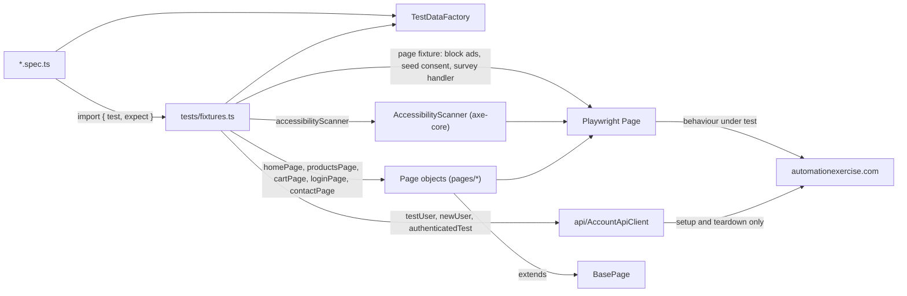

# E-Commerce Playwright

[](https://github.com/PimySoft/ecommerce-playwright/actions/workflows/playwright.yml)
[](https://pimysoft.github.io/ecommerce-playwright/)

An end-to-end test suite for the public demo shop [automationexercise.com](https://automationexercise.com), written in TypeScript with `@playwright/test`. It uses the Page Object Model with custom fixtures, and uses the site's API to create and delete test accounts but tests only through the browser. Alongside the functional journeys it checks accessibility against a documented baseline, compares stable page regions with screenshots, and runs the core journeys on a phone viewport. CI runs smoke tests on every pull request and the full suite on Chrome, Firefox, WebKit and a Pixel 7 for `main` and every night. The [latest report](https://pimysoft.github.io/ecommerce-playwright/) is published to GitHub Pages.

## Tech stack

| Area | Tool |
| --- | --- |
| Test runner | `@playwright/test`, pinned (Chrome, Firefox, WebKit and Pixel 7 projects) |
| Language | TypeScript, `strict: true` |
| Test data | `@faker-js/faker`, through `TestDataFactory` |
| Static checks | `typescript-eslint` + `eslint-plugin-playwright` |
| CI | GitHub Actions ([playwright.yml](.github/workflows/playwright.yml)), report on GitHub Pages |
| Accessibility | `@axe-core/playwright`, WCAG 2.1 A/AA |
| Visual | `toHaveScreenshot()`, baselines rendered in the Playwright Docker image |

## Quick start

```bash
npm ci
npx playwright install        # add --with-deps on Linux
npx playwright install chrome # only if Google Chrome isn't installed (the chrome project uses it)

npm test                      # all projects, headless
npm run test:chrome           # one browser
npm run test:smoke            # what pull requests run (on Chrome)
npm run test:regression
npm run test:mobile           # @smoke on a Pixel 7 viewport
npm run test:a11y             # accessibility checks
npm run test:visual           # visual checks, in Docker (needs Docker running)
npm run test:visual:update    # re-render the baselines in Docker
npm run test:headed           # watch it run
npx playwright test --ui      # debug in UI mode
npx playwright show-report    # open the last HTML report

npm run typecheck
npm run lint
```

No credentials are needed: every test account is generated for the run and deleted afterwards. Visual tests skip themselves outside Docker, because screenshots only match when rendered on the same OS, CPU architecture and browser build as CI.

## Project structure

```
api/
  AccountApiClient.ts   typed client for creating and deleting accounts (test setup only)
accessibility/
  AccessibilityScanner.ts  axe-core scan that reports only violations missing from the baseline
pages/                  page objects; each extends BasePage
  BasePage.ts           goto(), cookie-consent fallback, waiting for image-heavy pages
  components/           UI shared across pages, such as the add-to-cart modal
tests/
  fixtures.ts           extended test: ad blocking, consent seeding, popup handler,
                        page-object fixtures, test accounts, logged-in sessions, tag check
  *.spec.ts             one spec per feature area
  __screenshots__/      visual baselines
test-data/
  TestDataFactory.ts    single source for test inputs
  accessibilityBaseline.ts  known site violations, each with a reason
scripts/
  run-visual-in-docker.sh   runs the visual project in the same image as CI
playwright.config.ts    projects, retries, traces, reporters, baseURL
eslint.config.mjs       lint rules that enforce the coding standards
.github/                CI pipeline, PR template, CODEOWNERS
```

## Architecture



## Design decisions

- **Page objects are provided as fixtures.** Specs never call `new` on a page object or `page.goto` for it. Each fixture builds its page object and opens the page before the test body runs, so a test starts with the page it needs (`async ({ cartPage }) => …`). Journeys continue through methods that return the next page object. Page objects declare locators as getters and keep selectors and actions in separate sections.
- **One deterministic locator per element.** The preference order is role, then label, text, placeholder and test id (the site's own `data-qa` hooks), with scoped CSS as a last resort. There are no `.or()` fallback chains, no `.first()` to hide ambiguity and no XPath. Each locator was checked against the live accessibility tree.
- **The API sets up and the browser tests.** The `testUser` fixture creates an account through the site's API before a test and deletes it afterwards, even when the test fails. `authenticatedTest` logs in through the UI once per worker and reuses the session, so most logged-in tests skip the login form. Each worker gets its own account because the cart belongs to the account.
- **Third-party noise is removed at the network layer instead of handled with waits.** Ad networks inject full-screen interstitials and delay the load event, so the `page` fixture aborts their requests with `page.route`. Cookie consent is pre-set in `localStorage` with `addInitScript`. A Google survey dialog is dismissed by `addLocatorHandler` whenever it appears. The suite has no hard waits, and ESLint enforces that.
- **The ad script rewrites words in product titles into links.** So products are located by filtering the product card with `hasText` instead of by matching nested title text.
- **Accessibility fails only on what's new.** The site has violations it will never fix, such as icon-only buttons and low-contrast text. They are recorded per page with a reason in `accessibilityBaseline.ts`, and any other violation fails the test. If a recorded violation disappears, the report says so, so the baseline can be pruned.
- **Visual tests are deterministic or they aren't run.** They screenshot regions that only change with a redesign (header, footer, empty cart, category sidebar) and mask the floating scroll button. Baselines are rendered in the `mcr.microsoft.com/playwright` image on amd64, and CI compares them in the same image. CI also fails if the image tag drifts from the pinned Playwright version.
- **Mobile runs smoke only.** A phone viewport needs to prove the core journeys work. The regression detail is browser logic, which the desktop projects already cover.
- **Browser behaviour only.** API, unit and contract tests are out of scope. They belong at lower levels of the test pyramid, where they run faster and fail with more precise errors. This suite stays thin and covers the user journeys that only a browser can verify.

## Test coverage

Every test is tagged `@smoke` or `@regression`, and a fixture fails any test that isn't. Smoke is the handful of journeys that prove the site works, and the `mobile-chrome` project runs all of them on a Pixel 7.

| Journey | What is verified | Spec | Tag |
| --- | --- | --- | --- |
| Registration | Sign up with a generated user, "Logged in as", delete the account through the UI | [registration.spec.ts](tests/registration.spec.ts) | `@smoke` |
| Registration validation | Already-registered email is rejected; each required field blocks account creation (data-driven, one test per field) | [registration.spec.ts](tests/registration.spec.ts) | `@regression` |
| Login | Valid login with an API-created user | [authentication.spec.ts](tests/authentication.spec.ts) | `@smoke` |
| Login and logout | Login form, invalid credentials, invalid email format, logout | [authentication.spec.ts](tests/authentication.spec.ts) | `@regression` |
| Authenticated session | Reused `storageState` shows the user as logged in without a UI login | [session.spec.ts](tests/session.spec.ts) | `@smoke` |
| Checkout | Log in, add several products, verify delivery/billing address and order review, pay, order confirmation | [checkout.spec.ts](tests/checkout.spec.ts) | `@smoke` |
| Invoice download | Download after payment; file name and contents (buyer and total) | [checkout.spec.ts](tests/checkout.spec.ts) | `@regression` |
| Product details | Name, category, price, availability, condition and brand; add to cart with a custom quantity | [product-details.spec.ts](tests/product-details.spec.ts) | `@regression` |
| Search and add to cart | Every result matches the term; add-to-cart confirmation | [products.spec.ts](tests/products.spec.ts) | `@smoke` |
| Search edge cases | Empty search lists everything; no-match search lists nothing | [products.spec.ts](tests/products.spec.ts) | `@regression` |
| Category and brand filters | Filtered listing shows exactly the catalogue's products for that category or brand | [products.spec.ts](tests/products.spec.ts) | `@regression` |
| Cart | Remove a product; empty cart blocks checkout; guest is asked to log in at checkout and keeps the cart after logging in | [cart.spec.ts](tests/cart.spec.ts) | `@regression` |
| Guest purchase path | Home → products → add to cart → price, quantity and total in the cart | [e2e-workflow.spec.ts](tests/e2e-workflow.spec.ts) | `@regression` |
| Home page | Navigation links and heading | [homepage.spec.ts](tests/homepage.spec.ts) | `@smoke` |
| Subscription | Footer newsletter subscription shows the success message | [subscription.spec.ts](tests/subscription.spec.ts) | `@regression` |
| Contact | Contact form submission | [contact.spec.ts](tests/contact.spec.ts) | `@regression` |
| Accessibility | No WCAG 2.1 A/AA violations beyond the baseline on the home, products, cart, login and contact pages | [accessibility.spec.ts](tests/accessibility.spec.ts) | `@regression` `@a11y` |
| Visual | Header, footer, empty cart and category sidebar match their baselines | [visual.spec.ts](tests/visual.spec.ts) | `@regression` `@visual` |

## CI

[playwright.yml](.github/workflows/playwright.yml) type-checks and lints first, then runs the tests as a matrix of browser projects and shards.

| Trigger | Browsers | Tests | Shards per browser |
| --- | --- | --- | --- |
| Pull request to `main` | Chrome | `@smoke` | 1 |
| Push to `main` | Chrome, Firefox, WebKit, Pixel 7, visual | all | 2 (Pixel 7 and visual: 1) |
| Nightly (03:00 UTC) | Chrome, Firefox, WebKit, Pixel 7, visual | all | 2 (Pixel 7 and visual: 1) |
| Manual (`workflow_dispatch`) | chosen project or all | chosen tag or all | 1 for `@smoke`, otherwise 2 |

- Visual tests run in their own job inside the `mcr.microsoft.com/playwright` container, the same image their baselines were rendered in. On failure it uploads the expected, actual and diff images.
- Each shard writes a `blob` report. A merge job combines them into one HTML report, uploads it as the `playwright-report` artifact and, for runs on `main`, publishes it to [GitHub Pages](https://pimysoft.github.io/ecommerce-playwright/).
- Failed shards also upload `test-results/` (traces and screenshots). Traces are recorded on the first retry.
- A failed nightly run opens an Issue labelled `nightly-failure`, or comments on the one already open.
- npm packages and the Firefox and WebKit downloads are cached. The `chrome` project uses the Google Chrome build that the runner image ships.
- At most four test jobs run at once, and each uses one worker, because the target is a shared public site.
- On CI, failed tests are retried twice and `test.only` fails the run.

## Stability

Measured on 16 October 2026 with `--repeat-each=5`, no retries, two workers, from a laptop against the live site.

| Projects | Runs | Passed | Time |
| --- | --- | --- | --- |
| Chrome, Firefox, WebKit, Pixel 7 | 620 | 598 (96.5%) | 17.5 min |
| Visual (Docker) | 20 | 20 (100%) | 47 s |

All 22 failures were traced to the shared server, not the tests. Most were Cloudflare 520 error pages; the rest were dropped API connections, page-load timeouts, and two orders that the site invoiced with a total of 0 while it was returning those errors. None of them are test defects, and CI's two retries absorb this kind of failure. See the flakiness policy in [TEST_STRATEGY.md](TEST_STRATEGY.md) for how a failure is classified.

## Documentation

- [TEST_STRATEGY.md](TEST_STRATEGY.md): scope, risk-based priorities, test levels, environments and data, pipeline, entry and exit criteria, and the flakiness policy.
- [CONTRIBUTING.md](CONTRIBUTING.md): how to add a test, page object, accessibility or visual check, with the review checklist.
- [CODING_STANDARDS.md](CODING_STANDARDS.md): the rules, with examples. ESLint and the TypeScript compiler enforce most of them.

## License

MIT
