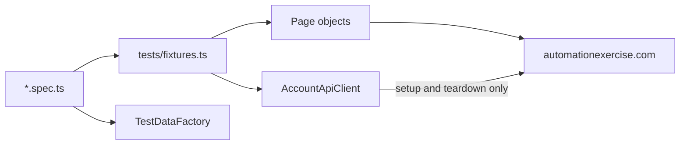

# E-Commerce Playwright

[](https://github.com/PimySoft/ecommerce-playwright/actions/workflows/playwright.yml)
[](https://pimysoft.github.io/ecommerce-playwright/)

Browser end-to-end tests for the demo shop [automationexercise.com](https://automationexercise.com), in TypeScript with `@playwright/test`. The suite covers the shopper's journeys on Chrome, Firefox, WebKit and a Pixel 7, plus accessibility and visual checks. The [latest report](https://pimysoft.github.io/ecommerce-playwright/) is on GitHub Pages.

## Quick start

```bash
npm ci
npx playwright install        # add --with-deps on Linux
npm run test:chrome           # one browser
npm test                      # every project
npm run test:smoke            # what pull requests run
npm run test:visual           # visual checks, in Docker
npm run typecheck && npm run lint
```

No credentials are needed. Every test account is created for the run and deleted afterwards.

## Stack

- `@playwright/test`, pinned, because the visual baselines depend on the browser build.
- TypeScript with `strict: true`.
- ESLint with `typescript-eslint` and `eslint-plugin-playwright`, which enforce most of the coding standards.
- `@faker-js/faker` for generated test data.
- `@axe-core/playwright` for WCAG 2.1 A/AA checks.
- GitHub Actions for CI, with the merged report published to GitHub Pages.

## Structure

```
tests/fixtures.ts     the extended test: ad blocking, consent, popup handler, page objects, accounts, tag check
tests/*.spec.ts       one spec per feature area
pages/                page objects, each extending BasePage; shared UI in pages/components/
api/                  account client, used for test setup only
accessibility/        axe-core scanner that reports only violations missing from the baseline
test-data/            TestDataFactory and the accessibility baseline
scripts/              runs the visual tests in the same Docker image as CI
```



## Design decisions

- **Page objects come from fixtures.** A test asks for the page it starts on (`async ({ cartPage }) => …`) and follows the journey through methods that return the next page object.
- **One verified locator per element.** Role first, then label, text, placeholder and the site's `data-qa` hooks, with scoped CSS as a last resort. No fallback chains, no `.first()`, no XPath.
- **The API sets up and the browser tests.** Fixtures create each account through the API and delete it even when the test fails. Logged-in tests reuse one session per worker.
- **Third-party noise is removed, not waited out.** Ads are blocked at the network layer, cookie consent is pre-set and a Google survey is dismissed by a locator handler. There are no hard waits.
- **Accessibility fails only on new violations.** Known site issues are recorded with a reason in `test-data/accessibilityBaseline.ts`.
- **Visual checks are deterministic.** They capture regions that only change with a redesign, and baselines are rendered and compared in the Playwright Docker image.
- **Browser behaviour only.** API, unit and contract tests belong lower in the pyramid. See [TEST_STRATEGY.md](TEST_STRATEGY.md).

## Coverage

Every test is tagged `@smoke` or `@regression`, and a fixture fails any test that isn't.

Smoke, which pull requests and the Pixel 7 run:
- Home page navigation and heading.
- Login with a valid account, and a reused logged-in session.
- Registration through the UI, ending with account deletion.
- Search results that all match the term, and the add-to-cart confirmation.
- Checkout with several products: addresses, order review, payment and confirmation.

Regression:
- Login form, invalid credentials, invalid email format and logout.
- Signup with an existing email, and each required signup field left empty.
- Empty and no-match searches, and category and brand filters.
- Product details, and adding a chosen quantity to the cart.
- Cart line items, removal, empty cart, and a guest cart that survives login.
- Invoice download after an order.
- Contact form and newsletter subscription.
- Accessibility on five key pages (`@a11y`), and four visual regions (`@visual`).

## CI

[playwright.yml](.github/workflows/playwright.yml) runs the type check and lint before any tests.

1. **Pull request:** `@smoke` on Chrome.
2. **Push to `main` and nightly at 03:00 UTC:** every project, desktop browsers in two shards each, plus the visual job in Docker. A failed nightly opens or updates an Issue labelled `nightly-failure`.
3. **Manual:** a chosen project and tag.

Shards' reports are merged into one HTML report. Failed tests retry twice, with a trace on the first retry. Each job uses one worker and at most four jobs run at once, because the site is shared.

## Stability

On 16 October 2026, 620 runs across the four browser projects (`--repeat-each=5`, no retries) passed 598 times, or 96.5%, in 17.5 minutes. All 22 failures came from the shared server: mostly Cloudflare 520 pages, plus dropped connections and timeouts. Two of them were orders invoiced with a total of 0 during those errors. The visual project passed 20 of 20.

## Further reading

- [TEST_STRATEGY.md](TEST_STRATEGY.md): scope, risks, pipeline and the flakiness policy.
- [CONTRIBUTING.md](CONTRIBUTING.md): how to add tests, page objects and checks.
- [CODING_STANDARDS.md](CODING_STANDARDS.md): the rules, with examples.

## License

MIT
